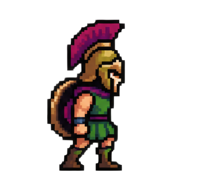
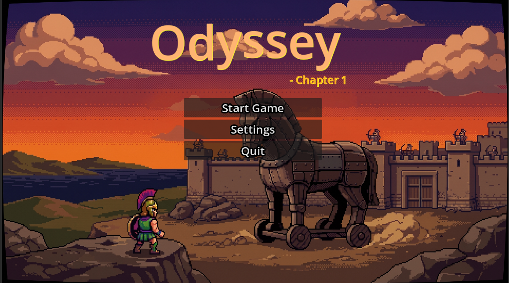
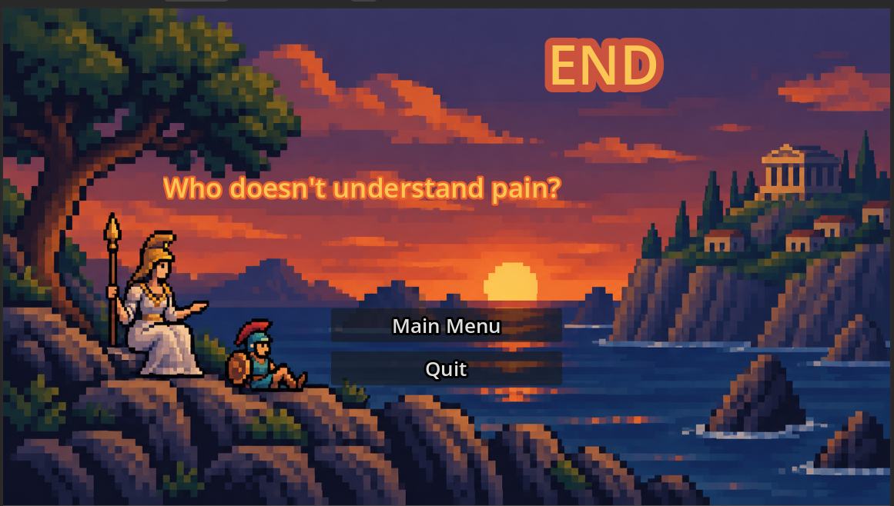
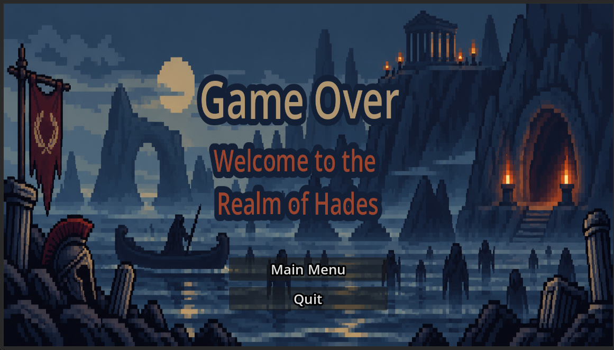

# The Game of Odyssey 

--- Escape back to Ithaca! ---

A 2D minigame collection inspired by WarioWare and Greek mythology, made in Godot! 

You can play it here: https://bluecore7.itch.io/the-game-of-odyssey

### The Game
#### The story starts right after the Battle of Troy. You and your crew are on a long sea voyage trying to get back home to your kingdom, Ithaca. On the way back, you're gonna face multiple life-taking challenges. Hold onto your hope and survive the trip!

It is a minigame built using Godot Engine and coded in GDScript. The mission is to reach Ithaca by clearing three obstructions that you should win in order to reach Ithaca.

When you load the minigame, you are greeted with 3 options:

1. **Start Game** - which takes you to the level screen where Athena (representing hopes/hearts/lives) is displayed and a 5-sec timer starts running. Once the timer ends, you are taken to the first level, Minigame_1.

2. **Settings** - when clicked, opens a settings window where you can mute/unmute the background music.

3. **Quit** - which, as the name suggests, quits the game.

In **Minigame 1 - The Blue Lotus**, collect all the lotuses before the timer runs out (eating them makes your crew forget about home). Collect them within 10 secs, else you will be taken back to the level screen and lose a hope.

If you successfully clear The Blue Lotus, you will move on to **Minigame 2 - The Sirens**. Spot the sirens to stop them from singing the song that takes your life. It is a "clicker game" where you have to spot and click the sirens (metaphorically this stops them from singing) to catch them, and you've got 10 secs to do it.

If you clear Minigame 2, you will be taken to **Minigame 3 - The Cyclopes**. You accidentally landed on the island where Poseidon's son lives. Escape from the one-eyed giant because a single hit will take your life! 

If you clear the last round, The Cyclopes - Congratulations!! You will be taken to the win screen - Ithaca, and you can play again if you want.

If you fail, then you lose all your lives and end up in Helios (Game Over), where you have the option to try again.

That's it as of now!

More minigames will be added soon. If you want to play this game: [click here](https://bluecore7.itch.io/the-game-of-odyssey)

### Controls / How to Play
- Use left (`<-`) and right (`->`) arrows to move!
- Use the `Space` button to jump!
- Use your mouse to click/spot things in certain stages!

Hope you have fun playing!

## Credits

- **Engine**: [Godot Engine](https://godotengine.org/)
- **Background Music**: `cynicbattleloop.ogg`
- **Sound Effects**: Typewriter clicks (`typewriter.wav`) and UI blips (`blip.wav`)